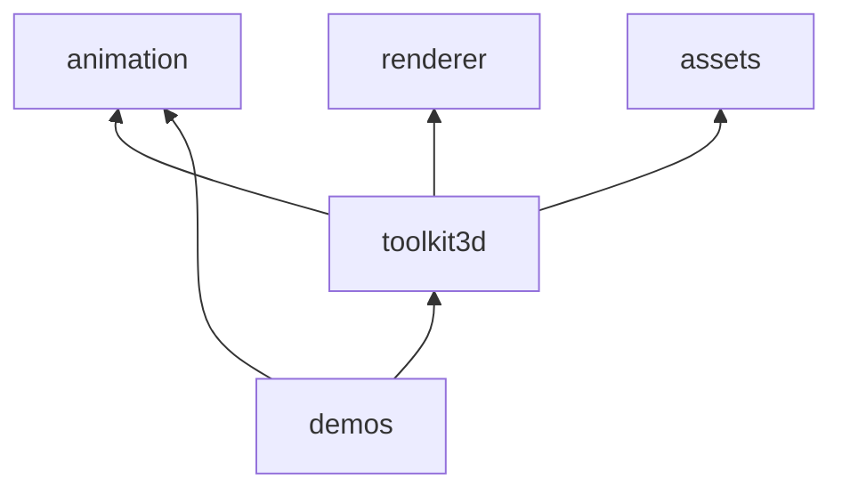

# Plano: animação esquelética 3D e IK

Status: **concluído.** Commits 1 a 6 implementados na branch `feature/skeletal-animation-ik` (módulo `animation` + JUnit, `renderer` com skin, `toolkit3d` com skinning, loader glTF, IK, `AnimationDemo` e docs). O que ficou de fora está em §11 e nas pendências do `DEVELOPMENT.md`.
Base: branch `feature/procedural-city` (módulos `core`, `renderer`, `assets`, `platform-glfw`,
`toolkit2d`, `toolkit3d`, `demos`).

## 0. Decisões tomadas (resumo)

| Tema | Decisão |
|---|---|
| Escopo de animação | **Esquelética 3D**: esqueleto, clips de keyframes por junta (T/R/S), skinning na GPU, crossfade. Sem animação de sprite 2D e sem tween de objetos nesta fase |
| Formato | **glTF 2.0** (`.gltf` e `.glb`) com **loader próprio**, sem dependência nova (parser JSON mínimo interno) |
| IK | **Two-bone analítico** (com pole), **FABRIK** para cadeias de N ossos e **look-at**; pós-processo sobre a pose animada, com peso |
| Onde mora a matemática | Módulo Maven novo **`animation`**: só JOML, sem GL e sem `core`, testável sem contexto |
| Onde mora o desenho | `renderer` ganha o mínimo genérico (atributos de skin, array de matrizes por comando); `toolkit3d` ganha shaders skinned, `SkinnedModel` e o loader glTF |
| Testes | Entra **JUnit 5** no build (primeiro uso), começando por `animation` e pelo leitor glTF |

## 1. Objetivo

1. Tocar clips de animação de personagens glTF com skinning na GPU, com sombra correta.
2. Trocar de clip com crossfade, sem salto.
3. Corrigir a pose animada em tempo real com IK (mão alcança um alvo, cabeça olha para algo,
   cadeia de N ossos segue um ponto).
4. Manter as regras de arquitetura: biblioteca, não framework, sem loop nem `update` mágico; o
   jogo chama `animator.update(dt)` no próprio loop.

## 2. Discovery: estado atual

- **Nenhuma animação na engine.** O xadrez (`demos/.../chess/model/ChessLogic`) anima poses
  "na mão" com `moveToward`; não é reaproveitável como sistema.
- `renderer/MeshData` é `record(vertices, textures, normals, indices)`. `Mesh` sobe 3 atributos
  fixos (0 posição, 1 UV, 2 normal), `GL_STATIC_DRAW`. Não há atributo de juntas/pesos.
- `renderer/Renderer.executePass`: os uniforms do `Material` são aplicados **uma vez por troca
  de material**. Por comando, só `uModel` e `uNormal`. Não existe uniform por instância nem
  `Shader.setMatrix4fArray`. Um palette de ossos por modelo exige mudar isso.
- `renderer/RenderCommand` é `record(mesh, material, modelMatrix)`.
- `toolkit3d/Shaders`: `STANDARD_VERTEX/FRAGMENT` (lit + sombra) e `SHADOW_DEPTH_*`, GLSL 330.
- `toolkit3d/LitMaterials` cria um shader compartilhado (lazy). `Shadows` tem um único
  `casterMaterial`; `ShadowMap.caster(mesh, matrix)` / `caster(TexturedModel)`.
- `toolkit3d/Models` só lê OBJ (cache por caminho via `Assets.open`; faz `1 - v` na UV).
  `TexturedModel` = mesh + material + TRS; `command()` cria matriz nova a cada chamada (o
  comando pode ser guardado até `endFrame`).
- `assets/TextureLoader` decodifica com STB **sem flip vertical**: a linha 0 da imagem fica em
  v = 0. Por isso o OBJ (origem embaixo) inverte v e o **glTF (origem em cima) não precisa
  inverter**. `Assets.texture(path)` só carrega de caminho, e um `.glb` com imagem embutida
  precisa de uma variante que receba bytes.
- `toolkit3d/Picking`, `Ray`, `Camera` existem (base para posicionar alvo de IK com o mouse).
- Dependências: LWJGL 3.3.6, JOML 1.10.8 (`Quaternionf.slerp/nlerp/rotationTo` prontos),
  Java 17. **Não há testes no build** (pendência em `DEVELOPMENT.md`).

## 3. Princípios (restrições do plano)

- **O jogo é dono do tempo:** nada avança sozinho. `Animator.update(dt)`, solvers de IK e
  `SkinnedModel.update()` são chamados pelo loop do jogo, nessa ordem.
- **`animation` é puro:** valores e funções, sem serviço, sem GPU. O jogo faz `new Animator(...)`
  (fora da regra "componente com serviço vem do módulo", como `Camera`).
- **O renderer continua genérico:** ele não sabe o que é "osso". Só aprende atributos inteiros
  extras e "um array de `mat4` por comando" com nome fixo (`uJoints`).
- **Sem alocação por frame** no caminho quente (amostragem, blend, IK, palette): arrays e
  scratch reaproveitados.
- **Convenções não vazam:** UV, ordem de quaternion (glTF é `x,y,z,w`) e column-major ficam no
  loader. A API usa `Vector3f`/`Quaternionf`/`Matrix4f` do JOML.
- **Toolkits não dependem entre si:** só o `toolkit3d` depende de `animation`.

### Por que `animation` não tem `Module`

Todo módulo de biblioteca hoje tem um `Module`, mas por consequência, não por regra: todos
expõem algo que depende de serviço. A regra 3 do `DEVELOPMENT.md` exige módulo só para
componentes **com dependência** (`Renderer`, `Assets`, ...), e a regra 9.5 manda matemática e
dados puros virarem tipo de valor ou função `static`, como `Camera`, `IsometricCamera`,
`DirectionalLight` e `Timer`, que têm construtor público. `Skeleton`, `Pose`, `AnimationClip`,
`Animator` e os solvers de IK não dependem de serviço, então são criados com `new`.

O que depende de serviço segue o padrão e sai do `Toolkit3DModule`: ler glTF e subir meshes
(`Models.loadGltf`), material skinned (`LitMaterials.createSkinned`) e caster skinned
(`Shadows`). Um `AnimationModule` registraria um serviço vazio e faria `animation` depender de
`core` sem ganho. Se um dia surgir algo com dependência (cache de clips por arquivo, por
exemplo), ele entra como serviço de um módulo.

## 4. Grafo de módulos

```
renderer ◄── core            (sem mudança)
animation                    (novo: só JOML)
toolkit3d ──► core, renderer, assets, animation
demos     ──► ... + animation
```



Artefato `java-game-engine-animation`, pacote `com.farias.jengine.animation`
(`...animation.ik` para os solvers).

## 5. Especificação: módulo `animation`

### 5.1 `Skeleton` (imutável)

```java
public final class Skeleton {
    public Skeleton(String[] names, int[] parents,
                    Vector3f[] restT, Quaternionf[] restR, Vector3f[] restS,
                    Matrix4f[] inverseBind);
    public int jointCount();
    public int parent(int joint);          // -1 = raiz
    public String name(int joint);
    public int indexOf(String name);       // -1 se não existir
    public Matrix4f inverseBind(int joint); // cópia ou view somente leitura
}
```

- Invariante: `parents[j] < j` (pai antes do filho). O construtor valida e lança
  `IllegalArgumentException`; o loader reordena as juntas para garantir isso e mapeia os
  índices de `JOINTS_0`.
- Várias raízes são permitidas (glTF permite).
- `jointCount() <= MAX_JOINTS` (128, §6.4) é validado no `toolkit3d`, não aqui.
- `Skeleton.ofRestPose(names, parents, t, r, s)`: fábrica que amarra o esqueleto no próprio
  repouso (inversa de bind = inversa da matriz de repouso). Para esqueletos montados em código.
- Os getters de repouso e de bind devolvem as views somente leitura do JOML (`Vector3fc`,
  `Quaternionfc`, `Matrix4fc`).

### 5.2 `Pose` (mutável, uma por instância)

```java
public final class Pose {
    public Pose(Skeleton skeleton);              // começa no repouso
    public Vector3f translation(int j);          // locais, mutáveis
    public Quaternionf rotation(int j);
    public Vector3f scale(int j);
    public Pose setToRest();
    public Pose set(Pose other);
    public Matrix4f modelSpace(int j);           // após computeModelSpace()
    public Pose computeModelSpace();             // model[j] = model[parent] * T*R*S
    public void skinningPalette(float[] out);    // out.length >= 16*jointCount
}
```

- `skinningPalette`: recalcula o espaço do modelo e escreve `model[j] * inverseBind[j]`,
  column-major, `Pose.FLOATS_PER_JOINT` (16) floats por junta.
- `computeModelSpace` percorre as juntas em ordem (garantida por §5.1), então basta um laço.

### 5.3 Clips e amostragem

```java
public enum Interpolation { STEP, LINEAR, CUBICSPLINE }

public record Track(int joint, Track.Path path, float[] times, float[] values, Interpolation interpolation) {
    public enum Path { TRANSLATION, ROTATION, SCALE }   // aninhado: evita colidir com java.nio.file.Path
    public float endTime();
    public void apply(float time, Pose pose);          // amostra e escreve na junta
}

public final class AnimationClip {
    public AnimationClip(String name, List<Track> tracks); // duração = maior último tempo
    public String name();
    public float duration();
    public void sample(float time, Pose out); // só escreve as juntas/canais com trilha
}
```

- `values`: 3 floats/keyframe (T, S) ou 4 (R, `x,y,z,w`). Em `CUBICSPLINE`, 3 elementos por
  keyframe (in-tangent, valor, out-tangent), como no glTF.
- Busca do keyframe: binária em `times`. Fora do intervalo, *clamp* no primeiro/último.
- `LINEAR` em rotação: `slerp` pelo caminho curto (troca o sinal se `dot < 0`).
- `CUBICSPLINE`: Hermite com tangentes escaladas por `Δt`; rotação normalizada no fim.
- Juntas/canais sem trilha **não** são tocados: quem chama começa de `setToRest()` (o
  `Animator` faz isso).

### 5.4 Blend e `Animator`

```java
public final class Poses {
    public static void blend(Pose a, Pose b, float weight, Pose out); // lerp T/S, slerp R
}

public final class Animator {
    public Animator(Skeleton skeleton);
    public Animator play(AnimationClip clip, boolean loop);       // corte seco
    public Animator crossFade(AnimationClip clip, boolean loop, float seconds);
    public Animator speed(float speed);                           // 1 = normal; negativo = ao contrário
    public float time();
    public Animator time(float seconds);
    public boolean finished();                                    // não-loop chegou ao fim
    public AnimationClip current();
    public void update(float deltaTime);                          // avança e amostra
    public Pose pose();                                           // resultado do último update
}
```

- Dois slots: atual e saindo. Durante o crossfade os dois avançam; peso linear
  `t / seconds`; ao terminar o slot que sai é descartado.
- Sem clip: `pose()` é o repouso.
- `crossFade` durante outro crossfade: a pose blendada do instante vira o "saindo" congelado
  (snapshot). Evita três slots.

### 5.5 IK (`com.farias.jengine.animation.ik`)

Todos operam **no espaço do modelo**: o alvo é dado em coordenadas do modelo (o `toolkit3d`
oferece `SkinnedModel.toModelSpace(world)`). Leem `pose.modelSpace` (o solver chama
`computeModelSpace()` antes, se preciso), escrevem **rotações locais** de volta na `Pose` e
deixam `modelSpace` atualizado ao sair. `weight` em [0, 1] faz `slerp` entre a rotação original
e a resolvida.

```java
public final class TwoBoneIk {
    public void solve(Pose pose, int root, int mid, int end,
                      Vector3fc target, Vector3fc pole, float weight);   // pole null = mantém o lado
}
public final class FabrikIk {
    public int solve(Pose pose, int[] chain, Vector3fc target,
                     int maxIterations, float tolerance, float weight); // devolve iterações usadas
}
public final class LookAtIk {
    public void solve(Pose pose, int joint, Vector3fc localForward,
                      Vector3fc target, float maxAngleRadians, float weight);
}
```

Os solvers são **instâncias reutilizáveis** (`new TwoBoneIk()` uma vez, `solve` a cada frame), e
não métodos `static`: cada um guarda o próprio scratch, para cumprir "sem alocação por frame".
Não são thread-safe. Uma classe interna (`IkJoints`) concentra a conversão de uma rotação no
espaço do modelo para a rotação local (`local * (mundo⁻¹ * delta * mundo)`).

- **Two-bone**: comprimentos `a = |mid-root|`, `b = |end-mid|`, alcance limitado a
  `[|a-b|, a+b]`. Em três passos: (1) dobra raiz e meio no plano atual para o triângulo ter os
  ângulos da lei dos cossenos; (2) gira a raiz para a ponta apontar para o alvo; (3) gira em
  torno do eixo raiz-alvo para o meio ficar do lado do `pole`. Com o braço reto, o plano vem
  do pole. Alvo fora de alcance → braço esticado na direção do alvo. Alvo sobre a raiz → não
  mexe (evita NaN). `root`, `mid` e `end` precisam ser ancestrais em cadeia (não
  necessariamente pai direto).
- **FABRIK**: `chain` = juntas da raiz à ponta, cada uma filha da anterior (validado).
  Iteração forward/backward nas posições até `|ponta - alvo| < tolerance` ou `maxIterations`.
  Depois converte em rotações: para cada osso, `rotationTo(direçãoAntiga, direçãoNova)`
  composto na rotação de mundo e trazido para o local do pai. Comprimentos preservados.
  Alvo inalcançável → cadeia reta apontando para o alvo.
- **Look-at**: gira `joint` para que `localForward` aponte para o alvo, limitado a
  `maxAngleRadians` a partir da rotação animada.
- Sem limites angulares por junta (cone/hinge) nesta fase.

Ordem num frame: `animator.update(dt)` → `pose.set(animator.pose())` (se for aplicar IK sem
sujar o animator) → solvers na ordem escolhida pelo jogo → `skinnedModel.update(pose)`.

## 6. Especificação: `renderer`

Mudanças compatíveis: nenhum demo atual precisa mudar.

### 6.1 `MeshData`

```java
public record MeshData(float[] vertices, float[] textures, float[] normals, int[] indices,
                       int[] joints, float[] weights) {
    public MeshData(float[] vertices, float[] textures, float[] normals, int[] indices) {
        this(vertices, textures, normals, indices, null, null);
    }
    public boolean skinned() { return joints != null; }
}
```

Validação: `joints` e `weights` juntos, 4 por vértice, mesmo número de vértices.

### 6.2 `Mesh`

- Com skin: atributo **3** `ivec4` (`glVertexAttribIPointer`, `GL_INT`) e atributo **4**
  `vec4` (pesos). VBOs extras liberados no `dispose`.
- `public boolean skinned()`.

### 6.3 `Shader` e `RenderCommand`

```java
// Shader
public void setMatrix4fArray(String name, float[] data, int count); // buffer direto reaproveitado

// RenderCommand
public record RenderCommand(Mesh mesh, Material material, Matrix4f modelMatrix, float[] jointPalette) {
    public RenderCommand(Mesh mesh, Material material, Matrix4f modelMatrix) {
        this(mesh, material, modelMatrix, null);
    }
}
```

`Renderer.executePass`: depois de `uModel`/`uNormal`, se `jointPalette != null`,
`shader.setMatrix4fArray("uJoints", palette, palette.length / 16)`. Como o warning de uniform
ausente só sai uma vez por nome, shaders sem skin não são afetados (o uniform nem é setado).

### 6.4 Limite de juntas

`Shaders.MAX_JOINTS = 128` (no `toolkit3d`, que é dono dos shaders; o renderer não conhece
ossos). São 2048 componentes de uniform: GL 3.3 garante 1024, mas macOS/desktop reais dão
4096+. O construtor de `SkinnedModel` recusa esqueleto maior, com mensagem clara. Não há
consulta a `GL_MAX_VERTEX_UNIFORM_COMPONENTS` (o toolkit não chama GL): numa GPU sem o limite,
o link do shader skinned falha com o log do driver. Palette em UBO ou textura fica para o futuro.

## 7. Especificação: `toolkit3d`

### 7.1 Shaders

`Shaders.SKINNED_VERTEX` tem o mesmo contrato de saída do `STANDARD_VERTEX` (`tex_coords`,
`fragNormal`, `fragLightSpace`), então o `STANDARD_FRAGMENT` é reaproveitado:

```glsl
layout(location = 3) in ivec4 joints;
layout(location = 4) in vec4 weights;
uniform mat4 uJoints[128];

mat4 skin = weights.x * uJoints[joints.x] + weights.y * uJoints[joints.y]
          + weights.z * uJoints[joints.z] + weights.w * uJoints[joints.w];
vec4 localPosition = skin * vec4(vertices, 1.0);
vec3 localNormal = mat3(skin) * normals;     // ok para skin sem escala não uniforme
```

`Shaders.SHADOW_DEPTH_SKINNED_VERTEX`: o mesmo skinning, só posição.

### 7.2 Materiais e sombra

- `LitMaterials.createSkinned(Texture)` → `LitMaterial` sobre o shader skinned (lazy,
  compartilhado). Toda a API de `LitMaterial` (luz, glossy, receiving, tint, emission) vale.
- `Shadows`: segundo caster material, skinned, criado junto do primeiro.
  `ShadowMap.casters(SkinnedModel)` devolve `List<RenderCommand>` (uma por parte), com a
  matriz de modelo e uma cópia do palette.

### 7.3 `SkinnedModel`

```java
public final class SkinnedModel {
    public record Part(Mesh mesh, Material material) {}
    public SkinnedModel(List<Part> parts, Skeleton skeleton);   // construtor público, como TexturedModel
    public SkinnedModel(Mesh mesh, Material material, Skeleton skeleton);
    public Vector3f getPosition(); public Vector3f getRotation(); public Vector3f getScale();
    public Matrix4f getModelMatrix();                    // mesma convenção T*R*S de TexturedModel
    public Skeleton skeleton();
    public List<Part> parts();
    public LitMaterial lit(int part);
    public void update(Pose pose);                       // recalcula o palette
    public List<RenderCommand> commands();               // um por parte; copiam o palette
    public Vector3f toModelSpace(Vector3f world, Vector3f out);
    public Vector3f jointWorldPosition(Pose pose, int joint, Vector3f out); // anexar objetos (arma na mão)
    public Matrix4f jointWorldMatrix(Pose pose, int joint, Matrix4f out);
}
```

- `commands()` copia o palette (≈ 8 KB a 128 juntas), como `TexturedModel.command()` copia a
  matriz: o comando pode ser guardado até `endFrame`, e `update` entre `submit` e `endFrame` não
  corrompe o frame.
- Um modelo glTF pode ter várias primitives (materiais diferentes): uma lista de
  (mesh, material) e o mesmo palette.
- O construtor recusa parte sem skin (`Mesh.skinned()`) e esqueleto acima de `MAX_JOINTS`.
- A posição/matriz de junta recebe a `Pose` porque o modelo só guarda o palette, não a pose.
- Verificado com um teste de fumaça (cilindro de 2 ossos dobrando por clip, com sombra):
  shaders linkam, a deformação é suave na junta e a sombra acompanha a pose.

### 7.4 Loader glTF (no pacote `com.farias.jengine.toolkit3d`)

As classes internas ficam no próprio pacote do `toolkit3d`, package-private: um subpacote
`gltf` obrigaria a deixá-las públicas para o `Models` usar (não há `module-info`). Separado em
**leitura pura** (testável sem GL) e **upload**:

| Classe | Visibilidade | Papel |
|---|---|---|
| `Json` | package-private | Parser JSON mínimo (objeto, array, string com escapes, número, bool, null), erros com posição |
| `GltfReader` | package-private | `.gltf` (buffers externos pelo `resolver` ou `data:` base64) e `.glb` (header + chunks JSON/BIN) → `GltfData` |
| `GltfData` | package-private | `Skeleton`, `List<Primitive(MeshData, Image, baseColor)>`, `List<AnimationClip>`, avisos |
| `ModelAsset` | público | Resultado carregado: meshes e texturas na GPU, `skeleton()`, `clips()`, `clip(name)`; `instance()` cria um `SkinnedModel` com materiais próprios |
| `Models.loadGltf(path)` | público | Carga com cache por caminho, como `Models.mesh`; avisos no stderr |

**Decisão de implementação: todo nó necessário vira junta.** O esqueleto não é só a lista
`skins[].joints`: são as juntas, os nós com malha da cena e todos os ancestrais deles,
ordenados por profundidade (pai antes do filho). Com isso:

- nós intermediários que não são juntas (o "Armature" do Blender, com escala ou rotação)
  entram naturalmente, e animações neles funcionam; não há junta raiz sintética;
- uma malha sem skin é presa rigidamente ao próprio nó (junta com peso 1), com os vértices
  levados ao espaço de bind desse nó; um arquivo sem skin anima os nós do mesmo jeito;
- todo modelo glTF é um `SkinnedModel`; não há caminho separado para `TexturedModel`;
- a inversa de bind vem da skin para as juntas e é a inversa da matriz de repouso para os
  demais nós; com várias skins, vale a primeira que lista o nó.

O custo é o limite de 128 juntas valer para os nós necessários, não só os ossos (o Fox da
Khronos tem 26).

Mapeamento glTF → engine:

| glTF | Engine |
|---|---|
| `accessors` + `bufferViews` (byteStride, byteOffset, `normalized`) | arrays `float[]`/`int[]`; componentTypes 5120–5126; accessor sem bufferView = zeros |
| `meshes[].primitives[]` (`mode` 4 apenas) | `MeshData` (POSITION, NORMAL, TEXCOORD_0, JOINTS_0, WEIGHTS_0, indices). Sem NORMAL → normais suaves pelas faces. Sem indices → 0..n-1 |
| nó com `skin` | posições como no arquivo (a transformação do próprio nó é ignorada, como manda o glTF); `JOINTS_0` remapeado para o esqueleto |
| `nodes[]` TRS / `matrix` | pose de repouso local (`matrix` decomposta em TRS) |
| `scene` / `scenes[0]` | só os nós da cena padrão (sem cenas: todas as raízes) |
| `animations[].channels/samplers` (`translation`/`rotation`/`scale`) | `Track` + `Interpolation`; canais `weights` (morph) e de nós fora do modelo ignorados com aviso |
| `materials[].pbrMetallicRoughness.baseColorTexture` | `Texture`. URI → `Assets.texture(dir + uri)`; embutida (bufferView/`data:`) → `Assets.texture(path + "#image" + i, bytes)`. Sem textura → textura 1×1 de `baseColorFactor` (o fator não multiplica uma textura existente) |
| UV | **sem** `1 - v` (ver §2) |
| Pesos | renormalizados para somar 1 (soma zero → peso 1 na junta do nó) |

- Fora do suporte: extensões obrigatórias (`extensionsRequired`, ex.: Draco) e sparse
  accessors dão `UnsupportedOperationException`; morph targets, modos que não são triângulos e
  skin sem `JOINTS_0`/`WEIGHTS_0` (desenhada rígida) viram aviso.
- Verificado com o `Fox.glb` da Khronos (CC-BY 4.0): 26 juntas, clips Survey/Walk/Run,
  textura embutida e UV corretas, animação tocando na GPU.

### 7.5 `assets`

- `Assets.texture(String cacheKey, byte[] encoded)`: decodifica de memória com o mesmo
  `TextureLoader` e cacheia pela chave (ex.: `"models/fox.glb#image0"`).

## 8. Demo `AnimationDemo` (pacote `examples.animation`)

- Personagem: `resources/models/fox.glb` (Khronos `Fox`: modelo CC0, rig/animações e conversão
  CC-BY 4.0), com atribuição em `resources/models/ATTRIBUTION.md`. Escala 0,02 (o arquivo está
  em centímetros).
- Teclas: `1..3` trocam o clip (Survey, Walk, Run) com crossfade de 0,3 s; `ESPAÇO` pausa;
  `P`/`L`/`T` ligam e desligam pata, olhar e tentáculo; `Q`/`E` sobem e descem o alvo; setas
  giram a câmera; roda = zoom. Ficaram de fora a velocidade por tecla e o peso por tecla.
- IK: o alvo segue o mouse (raio da câmera × plano `y` = altura do alvo, `Picking.ray` +
  `rayPlaneY`). Two-bone na pata dianteira esquerda (`b_LeftUpperArm_09` → `b_LeftForeArm_010` →
  `b_LeftHand_011`, cotovelo dobrando para trás); look-at em `b_Head_05` (eixo "frente" da cabeça
  calculado da pose de repouso, até 70°); tentáculo de 8 ossos gerado em código (`Tentacle`:
  `Skeleton.ofRestPose` + `MeshData` com skin) com FABRIK, com a pose mantida entre frames.
- Sombra direcional (casters skinned), HUD com `Ui`.
- Entra no `Launcher` (opção 7), na tabela de demos do README e em `scripts/run-demos.sh`.
- Verificado com frames capturados por um harness descartável (alvo no chão: pata e tentáculo
  tocam o marcador e a cabeça se vira; alvo alto: tentáculo se curva até ele, pata estica). A
  interação com mouse e teclado não foi exercitada por um humano.

## 9. Sequência de commits

1. **Módulo `animation` + JUnit 5**: POM raiz (módulo, `dependencyManagement`, JUnit com versão
   fixa, conforme o enforcer), `Skeleton`, `Pose`, `Track`, `Interpolation`, `AnimationClip`,
   `Poses`, `Animator` e testes.
2. **`renderer`**: skin em `MeshData`/`Mesh`, `Shader.setMatrix4fArray`, palette em
   `RenderCommand`/`Renderer`. `scripts/run-demos.sh` sem regressão.
3. **`toolkit3d` (desenho)**: shaders skinned, `LitMaterials.createSkinned`, caster skinned,
   `SkinnedModel`; dependência de `animation` no POM.
4. **glTF**: `Assets.texture(key, bytes)`, `Json`, `GltfReader`, `GltfData`, `ModelAsset`,
   `Models.loadGltf`; testes com `.gltf` mínimo em `src/test/resources` (triângulo com 2 juntas
   e 1 clip; uma versão `.glb` equivalente).
5. **IK**: `TwoBoneIk`, `FabrikIk`, `LookAtIk` + testes.
6. **Demo e docs**: `AnimationDemo`, asset com atribuição, README (tabela de módulos, grafo
   mermaid, demos), `DEVELOPMENT.md` (seção `animation`, convenções do glTF, pendências).

## 10. Verificação

Testes automáticos (`./mvnw test`):

- Amostragem: STEP mantém o valor; LINEAR no meio do intervalo; CUBICSPLINE bate com valores
  de referência; clamp fora do intervalo; slerp pelo caminho curto com quaternions opostos.
- `Pose`: no repouso, `skinningPalette` dá identidade em todas as juntas; hierarquia de 3
  juntas compõe as matrizes na ordem certa.
- `Animator`: loop dá a volta; não-loop fica `finished`; crossfade em t = 0 é o clip antigo e
  em t = duração é o novo; crossfade durante crossfade não salta.
- Two-bone: alvo alcançável → ponta a ε do alvo e comprimentos preservados; inalcançável →
  esticado na direção; pole muda o lado da flexão; `weight = 0` não altera a pose.
- FABRIK: converge abaixo da tolerância; preserva comprimentos; alvo inalcançável → reta.
- Look-at: respeita `maxAngle`.
- glTF: parser JSON (escapes, números, aninhamento, erros com posição); accessors com stride e
  `normalized`; reordenação de juntas; `.gltf` e `.glb` produzem o mesmo `GltfData`.

Manual:

- `./mvnw -DskipTests install` e `scripts/run-demos.sh`: todos os demos antigos abrem.
- `./mvnw -pl java-game-engine-demos exec:exec -Dexec.mainClass=com.farias.jengine.examples.AnimationDemo`:
  clip tocando, crossfade sem salto, sombra acompanhando a pose, membro seguindo o mouse,
  cabeça mirando, tentáculo FABRIK.

## 11. Fora do escopo (futuro, registrar em `DEVELOPMENT.md`)

- Camadas de animação com máscara por junta e blend aditivo.
- Root motion e eventos de animação (passos, sons).
- Morph targets / blend shapes.
- Limites angulares por junta no IK (cone, hinge) e IK de corpo inteiro.
- Palette em UBO/textura (mais de 128 juntas, instancing de multidões).
- Animação de sprite 2D (`SpriteSheet` + frames) e tween de propriedades.
- Extensões glTF (Draco, `KHR_texture_transform`, `KHR_materials_*`) e PBR.

## 12. Riscos e pontos de atenção

- **Primeira mudança no caminho quente do `Renderer`** desde a modularização: medir que
  `executePass` não ficou mais lento para comandos sem palette (é um `if` por comando).
- **Normais com escala não uniforme** no skin: `mat3(skin)` é aproximação; aceitável para os
  assets-alvo. A correção (inversa-transposta por vértice) fica para quando aparecer o caso.
- **Ordem das juntas no glTF** não é garantida: a reordenação + remapeamento de `JOINTS_0` é
  o ponto mais sensível do loader e tem teste dedicado.
- **Convenções de quaternion** (`x,y,z,w` no glTF e no JOML) e matrizes column-major (glTF,
  JOML e GL concordam): ficar nos testes, não confiar.
