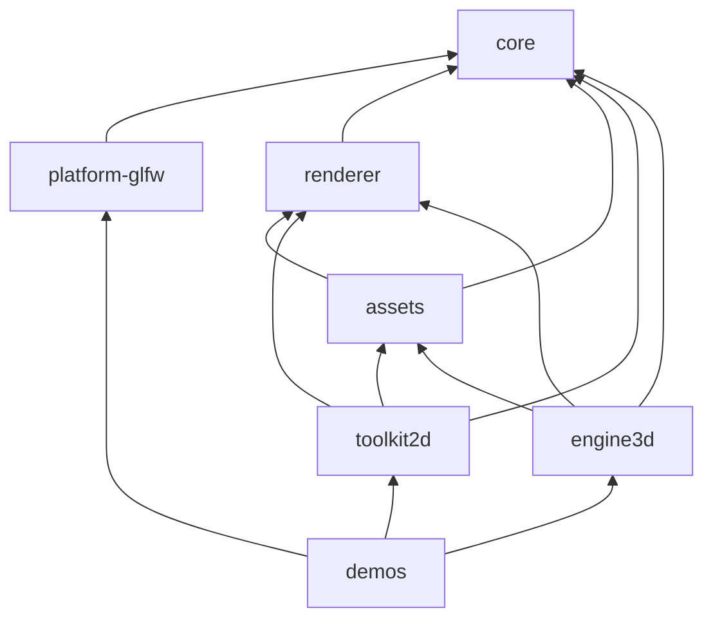

# Java Game Engine

A small, modular game engine for Java built on [LWJGL](https://www.lwjgl.org/) (OpenGL + GLFW).

It is a **library, not a framework**: your game owns `main` and the game loop, and picks the
pieces it needs by registering modules. There is no base class to extend.

> Status: in development. Tested on macOS (arm64). The Linux/Windows native profiles are written
> but have not been exercised.

## What you get

- Window and input (GLFW), behind small interfaces.
- A modular, pass-based OpenGL renderer: render passes, materials, depth/shadow mapping.
- A 2D toolkit: sprite sheets, bitmap text, a `Canvas` for 2D scenes and a `Ui` overlay for HUDs.
- A 3D toolkit: OBJ models, lit materials, cameras and projections.
- An asset service with a texture cache.
- A tiny kernel (`Engine`, `Module`, `EngineContext`) that wires everything together.

## Quick start

Requires **JDK 17+**. Maven is provided by the wrapper (`./mvnw`); LWJGL natives are picked
from your OS/architecture automatically.

```bash
./mvnw -DskipTests install                      # build and install all modules

# run the demo launcher (uses -XstartOnFirstThread on macOS automatically)
./mvnw -pl java-game-engine-demos exec:exec

# or a specific demo
./mvnw -pl java-game-engine-demos exec:exec \
    -Dexec.mainClass=com.farias.rengine.examples.SnakeGame
```

Demos read `resources/...` relative to the working directory, so they must run from
`java-game-engine-demos/` (`exec:exec` already does that).

To smoke-run every demo for a few seconds each (it only checks that they open and stay up):

```bash
scripts/run-demos.sh          # 5 s per demo
scripts/run-demos.sh -t 10 SnakeGame ModelViewer
```

| Demo | Shows |
|---|---|
| `SnakeGame` | 2D with `Canvas` |
| `SpriteEditor` | 2D pixel-art editor with `Canvas` and mouse input |
| `ModelViewer` | 3D perspective scene + `Ui` overlay |
| `IsometricChess` | 3D isometric scene + `Ui` overlay |
| `ShadowCubeDemo` | `Engine` + `Renderer` used directly, two-pass shadow mapping |

## A minimal game

```java
public static void main(String[] args) {
    Engine engine = new Engine()
            .registerModule(new GlfwModule(640, 480, "Hello"))          // Window + InputSystem
            .registerModule(new RenderModule())                         // Renderer (OpenGL)
            .registerModule(new AssetsModule(Path.of("resources")))     // Assets
            .registerModule(new Toolkit2DModule(320, 240));             // Canvas + Ui

    EngineContext context = engine.start();
    try {
        Window window = context.require(Window.class);
        InputSystem input = context.require(InputSystem.class);
        Renderer renderer = context.require(Renderer.class);
        Canvas canvas = context.require(Canvas.class);

        Timer timer = new Timer();
        while (!window.shouldClose() && !input.isKeyPressed(Key.ESCAPE)) {
            timer.update();
            input.update();
            // update(timer.deltaTime());

            renderer.beginFrame();
            canvas.begin();
            canvas.textCentered(canvas.defaultFont(), "Hello", 160, 100);
            renderer.endFrame();             // executes the passes and presents
        }
    } finally {
        engine.terminate();                  // reverse order of registration
    }
}
```

Coordinates in `Canvas`/`Ui` are virtual units (the size given to `Toolkit2DModule`), origin at
the **top-left**, **Y grows downward**, rotation in degrees **clockwise**.

## Modules

| Module | Responsibility | Depends on |
|---|---|---|
| `core` | Kernel: `Engine`, `Module`, `EngineContext`, `Timer`; contracts `Window`, `InputSystem`, `Key`, `MouseButton` | nothing |
| `platform-glfw` | `GlfwModule`: window + input through GLFW | core |
| `renderer` | `Renderer`, `RenderModule`, passes, materials, meshes, shaders, textures (OpenGL) | core |
| `assets` | `Assets`, `AssetsModule`: path resolution and texture cache | core, renderer |
| `toolkit2d` | `Canvas`, `Ui`, `SpriteSheet`, `BitmapFont`, `Toolkit2DModule` | core, renderer, assets |
| `engine3d` | `Camera`, `Meshes`, `Materials`, `ModelLoader`, `Engine3DModule` | core, renderer, assets |
| `demos` | Example games | platform-glfw, toolkit2d, engine3d |



## Architecture rules

These rules are the architectural proposal of the engine. Breaking one should be a deliberate
decision, not an accident. The reasoning behind each rule is in
[DEVELOPMENT.md](DEVELOPMENT.md#regras-de-arquitetura-o-porquê).

1. **Library, not framework:** the game owns `main` and the loop; there is no base class to extend.
2. **Composition through modules:** the game registers the modules it needs; services come from
   `EngineContext.require(...)`.
3. **Components with dependencies come from modules:** the game does not `new` them; `static` is for
   pure functions only.
4. **Dependency direction:** `core` depends on nothing; library modules never depend on
   `platform-*`; `toolkit2d` and `engine3d` never depend on each other.
5. **Platform is a contract:** `Window` and `InputSystem` are interfaces in `core`, implemented by
   `platform-*` modules.
6. **One frame lifecycle:** `beginFrame` → passes → `endFrame`; overlays are begun after the scene.
7. **Resource ownership:** the `Renderer` owns GPU resources; `Assets` caches textures.
8. **Conventions do not leak:** clip space, UV and winding stay inside the toolkits.
9. **Where new code goes:** graphics API → `renderer`; OS library → `platform-*`; 2D-only or
   3D-only → its toolkit; anything with a service → a module.

## Known limitations (deliberate, not forgotten)
- The renderer is **OpenGL-only**: `Mesh`, `Shader` and `Texture` are concrete OpenGL classes
  and the `Renderer` binds programs, sets uniforms by name and draws directly. A second backend
  would need opaque resource handles plus a `RenderBackend` SPI that executes a whole frame
  (`execute(frame)`); that is intentionally not built until it is actually needed.
- The OpenGL 3.3 core context request still lives in `platform-glfw`.
- Shader sources are GLSL 330 strings inside `toolkit2d` and `engine3d`.
- `Matrix4f` (JOML) appears in the renderer API.

## Project notes

- `DEVELOPMENT.md`: module details, build decisions, lessons from past bugs and open items (pt-BR).
- `java-game-engine-demos/CHESS_MODELS.md`: why the chess models need `flipNormals`.
